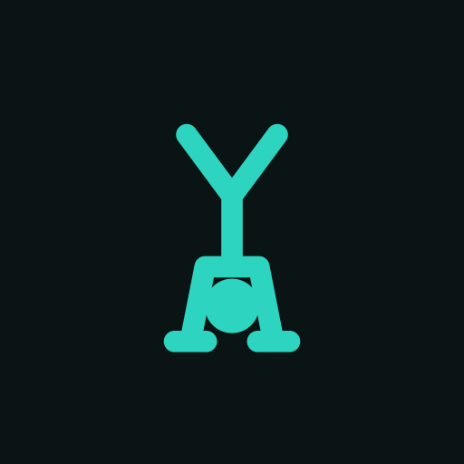

<div align="center">



# openBody

**A self-hosted calisthenics and mobility tracker you actually own.**

Climb skill ladders from tuck to full front lever, follow hands-free mobility flows,<br>
measure your flexibility, and run ready-made programs, on your phone, behind your own passkey login.

Forked from [openGym](https://github.com/DuarteSantos8/openGym) by Duarte Santos (AGPL-3.0) and refocused on bodyweight training.

</div>

## Why openBody

openGym is an excellent self-hosted gym tracker. openBody keeps everything that makes it good: passkey login, your own server, offline PWA, sync, history, the fatigue body map, the progression engine and the importers. It retargets all of that at **calisthenics and mobility**:

- Gym equipment is hidden by default. New profiles start on a built-in **Calisthenics** equipment profile: body weight, bar, rings and suspension, bands, weighted vest and belt, and mobility props. "Show all equipment" still reaches the full 5,600-exercise catalogue.
- Progress means **harder variations**, not just more weight. The skill ladders move your routine to the next variation once your log says you have earned it.
- Mobility is training. Guided flows are logged like any workout, and flexibility tests chart your range of motion over time.

## Features

**Explore** (one tab, five sections)

- **Exercises**: the full catalogue with a new **Area** filter (hips, hamstrings, thoracic spine, shoulders, wrists, ankles…) next to body part, type and equipment.
- **Workouts**: 40 ready-made sessions. Chest, back, shoulders, arms, core, legs and full body come at beginner, intermediate and advanced, plus mobility and strength-endurance sessions for every body area. **Start now**, or add one to your plan.
- **Skills**: 12 skill ladders (front lever, back lever, planche, handstand, handstand push-up, muscle-up, pistol squat, human flag, L-sit, one-arm pull-up, one-arm push-up, dragon flag).
  - Every step has a practice target and an unlock bar ("3 × 15 s, in 2 sessions").
  - Your current step is **derived from your log**, never stored, and "I can already do this" sets a floor.
  - A routine entry that follows a ladder moves to the next variation by itself.
- **Mobility**: 12 guided flows (morning flow, hip opener, splits prep, pancake, wrist prep, shoulder and thoracic, cool-down…).
  - A full-screen, hands-free player with a countdown ring, 3-2-1 beeps, a chime per hold and left/right sides.
  - The screen stays awake, and a flow survives a reload or a sleeping phone.
- **Tests**: 11 flexibility tests (toe touch, front and side split, pancake, shoulder flexion, bridge, knee to wall, deep squat hold, active straight-leg raise, back scratch, wrist extension).
  - Each has benchmark bands from poor to elite, and a test-day wizard walks you through them.
  - Each test has its own trend chart, and a **mobility map** on the body diagram shows the result.

**Programs**: six built-in programs replace the barbell starter plans: Fundamentals, the r/bodyweightfitness **Recommended Routine**, Skills & Strength, Mobility 30, Splits in 60, and Hybrid.
- Enrolling fills your weekly plan with ordinary routines, and never deletes your own.
- Home shows the week you are in, your adherence, today's mobility flow (one tap to start) and when your next test day is due.

**Everything openGym already did**: routines and weekly plans or rotations, supersets, warm-ups, per-side sets, RIR/RPE, the progression engine (now with calisthenics defaults: reps climb a range, holds add time), history, PRs, stats and the activity heatmap, body weight and measurements, progress photos, the muscle fatigue map, the optional AI coach (retargeted at calisthenics), an MCP server (with `list_skills_progress` and `list_assessments`), imports from FitNotes, Strong and Hevy, backups, and 20 languages.

**Stats** adds a "Skills & mobility" card: skills mastered, steps unlocked, your mobility band, and eight weeks of hold time vs mobility time.

## Exercise media

The 5,600 upstream exercises keep openGym's licensed media (see [License](#license) and `catalogue/media/NOTICE.md`). The 43 exercises openBody added use open media in `catalogue/media-open/`: public-domain photos from free-exercise-db, and original SVG illustrations. Every file is credited in `SOURCES.md`.

## Quick start

You need [Docker](https://docs.docker.com/get-docker/) with Compose.

```bash
git clone https://github.com/nawafSheddi/openGym openbody
cd openbody
cp .env.example .env
docker compose up -d --build   # builds both images from this checkout
```

Open <http://localhost:8080>, tap **Create profile**, and you're in. The exercise animations are
part of the image, so there's nothing else to download.

To reach it from your phone with passkeys you need HTTPS on a domain; that's a two-line change in
`.env`. The [self-hosting guide](docs/SELF_HOSTING.md) walks through Cloudflare Tunnel, Caddy,
Traefik and nginx, and there are separate guides for
[HTTPS on a LAN](docs/SELF_HOSTING_HTTPS.md) and [Kubernetes](docs/SELF_HOSTING_KUBERNETES.md).

> [!NOTE]
> openBody publishes no prebuilt images: `docker-compose.yml` builds `openbody-api:local` and
> `openbody-web:local` from your checkout (`pull_policy: build`). The `ghcr.io/duartesantos8/opengym-*`
> images are upstream openGym, a different app. You don't need Node on the host.

<details>
<summary><b>Configuration reference</b> (all through <code>.env</code>)</summary>

| Variable | What it does | Default |
|---|---|---|
| `RP_ID` | Hostname passkeys are bound to | `localhost` |
| `ORIGIN` | Full URL the app is served from | `http://localhost:8080` |
| `WEB_PORT` | Host port for the web UI | `8080` |
| `NGINX_PORT` | Port the web container listens on inside the container | `80` |
| `BACKEND` | Name of the API service that `/api` is proxied to | `api` |
| `PORT` | Port the API listens on; the web container proxies to the same value | `3000` |
| `RP_NAME` | Name shown in the passkey prompt | `openBody` |
| `SESSION_DAYS` | How long a sign-in lasts, in days | `90` |
| `ADMIN_UIDS` | User ids that get the admin dashboard, comma-separated | *(none)* |
| `FIRST_USER_ADMIN` | `1`: the first profile created on an empty instance becomes its admin | *(off)* |
| `INVITE_ONLY` | Require an invite code to create a profile | *(off)* |
| `ALLOW_GUEST` | Offer "Continue without account"; `0` requires a profile | *(on)* |
| `PASSWORD_LOGIN` | Offer name-and-password sign-in next to passkeys | *(off)* |
| `TRUST_PROXY` | Let the sign-in throttle read the client address from proxy headers | `1` in `docker-compose.yml` |
| `AUDIT_LOG` | Record sign-ins and admin actions; `0` records nothing | *(on)* |
| `AUDIT_MAX` | Events kept in the activity log; `0` for no limit | `5000` |
| `AUDIT_DAYS` | Days kept in the activity log; `0` keeps until `AUDIT_MAX` | `90` |
| `AUDIT_IP` | Record the caller's address: `off`, `net` (network only) or `full` | `off` |
| `ALLOWED_PRIVATE_IPS` | Private addresses push endpoints may resolve to (FakeDNS, split-horizon DNS): comma-separated IPs, `a-b` ranges or CIDR blocks | *(none)* |
| `VAPID_SUBJECT` | Contact URL sent with push notifications | your `ORIGIN` |
| `API_TARGET` | API image to build: `default`, or `coach` with the Claude Agent SDK and Codex CLI | `default` |
| `COACH_DISABLED` | `1` forces the AI coach off instance-wide | *(unset)* |

Push-notification keys are generated on first run into `./data/vapid.json`. `DATA_DIR` is pinned to
`/data` inside the container and mapped to `./data` on the host; change the volume, not the
variable. The [self-hosting guide](docs/SELF_HOSTING.md) covers every option in detail.

</details>

## Phone app

The same codebase builds a standalone app with Capacitor: no account, no server, everything stays
on the phone, with native reminders and a rest countdown in the notification shade.

- **Android:** download the signed APK from the [latest release](https://github.com/DuarteSantos8/openGym/releases/latest)
  or the [website](https://opengym.ch). Each build sits next to its `.sha256`, and
  the app checks for updates itself. openBody is deliberately not on the Play Store.
- **iPhone:** Apple doesn't allow installs outside the App Store. Self-host and add the PWA to your
  home screen from Safari, or build the native app onto your own device with Xcode.

Details and build instructions: [docs/MOBILE.md](docs/MOBILE.md).

## How it works

<p align="center">
<picture>
  <source media="(prefers-color-scheme: dark)" srcset="docs/diagrams/architecture-dark.png">
  
</picture>
</p>

- **`frontend/`** is React 19 and Vite (React Router, Zustand), built to static files inside Docker.
- **`api/`** is plain `node:http` with two dependencies: `@simplewebauthn/server` for passkeys and
  `web-push` for notifications. Everything is stored as JSON under `./data`.
- **`web/`** builds the frontend and serves it with nginx, proxying `/api` so the whole app sits on
  one origin, which passkeys require.

The training logic (progression rules, 1RM, how a logged session is read back) lives in pure
functions under `frontend/src/lib/` with tests beside them. The HTTP API is documented as an
OpenAPI spec in [`api/openapi.yaml`](api/openapi.yaml), browsable at
[opengym.ch/api.html](https://opengym.ch/api.html).

### How sync works

Each profile's data is one document with a server revision. A device sends the revision it last
saw along with its changes; if another device wrote in between, the server refuses and returns the
current document so the device can merge and retry. Every change carries its own stamp, down to a
single setting or routine field, so the merge keeps the newest edit of each one and a deletion stays
deleted.

<p align="center">
<picture>
  <source media="(prefers-color-scheme: dark)" srcset="docs/diagrams/sync-dark.png">
  
</picture>
</p>

Nothing that hasn't reached the server is discarded on disconnect or sign-out, and the app shows a
banner whenever it's working offline.

### Your data

Everything lives in `./data` on your host:

| File | Contents |
|---|---|
| `db.json` | Profiles and public passkey data |
| `db.json.bak` | A copy of the last good `db.json`, used if the main file can't be read |
| `state-<user>.json` | Each user's plan, workouts, body weight and settings |
| `audit.log` | Admin activity log (no IP addresses unless you turn that on) |
| `secret` | Session-cookie signing key |

Back up `./data` and you've backed up everything. Passkey private keys never reach the server; they
stay in your phone's secure hardware or your password manager.

## Documentation

The [documentation index](docs/README.md) sorts every guide by who it's for. The most used ones:

| I want to | Read |
|---|---|
| Get a quick answer | [FAQ](docs/FAQ.md) |
| Set up my own instance | [Self-hosting](docs/SELF_HOSTING.md) |
| Use the Android or iPhone app | [Phone app](docs/MOBILE.md) |
| Bring my history from another app | [Importing data](docs/DATA_IMPORTS.md) |
| Turn on the AI coach | [AI coach](docs/AI_COACH.md) |
| Contribute code | [Contributing](CONTRIBUTING.md) |
| Report a security problem | [Security](SECURITY.md) |

## Roadmap

A release roughly every two weeks, each small and themed. The full plan is in
[ROADMAP.md](ROADMAP.md), and the issues sit in the
[GitHub milestones](https://github.com/DuarteSantos8/openGym/milestones). The next two releases
finish the community wishes, then comes a new exercise database and a themed release every
two weeks after it.

| Release | When | Theme |
|---|---|---|
| v1.3.10 | released Oct 2026 | New design, rotation, swipe actions, safer sync |
| v1.3.11 | next | Fixes, about thirty community pull requests, Health Connect, measurements |
| v1.3.12 | Nov 2026 | Community features: focus view, widget, timer rework |
| v1.4.0 | Nov 2026 | A new exercise database |
| v1.4.1 to v1.4.4 | Dec 2026 and Jan 2027 | Programmes, the progression engine, cardio |
| v1.4.5 to v1.4.10 | Jan to Apr 2027 | Search, accounts, the iOS app, Android and health, looks |
| later | | Database storage |

## Community

- **[Discord](https://discord.gg/e62jY6fwVb)** for release announcements, self-hosting help and
  quick back-and-forth. Usually the fastest way to get an answer.
- **[Discussions](https://github.com/DuarteSantos8/openGym/discussions)** for questions and ideas
  you want the next person to find by searching.
- **[Issues](https://github.com/DuarteSantos8/openGym/issues)** for reproducible bugs and agreed-on
  work. Login trouble is almost always an `RP_ID`/`ORIGIN` mismatch; the
  [self-hosting guide](docs/SELF_HOSTING.md) covers it.
- **[Pull requests](https://github.com/DuarteSantos8/openGym/pulls)** are welcome; start with
  [CONTRIBUTING.md](CONTRIBUTING.md).

<a href="https://github.com/DuarteSantos8/openGym/graphs/contributors">
  
</a>

### Where the code lives

GitHub is the home of the project. [gitlab.com/DuarteSantos8/opengym](https://gitlab.com/DuarteSantos8/opengym)
is a mirror, updated by a GitHub Actions workflow on every push to `main` and every release tag. It
exists because its CI builds the release artifacts: the signed APK, the multi-arch images and the
SBOMs. Nothing is merged there by hand. In the changelog, `!NN` refers to a GitLab merge request
from the weeks in August and September 2026 when the project lived there.

## How openBody is built

People have asked about this, so plainly: **openBody is developed with
[Claude Code](https://claude.com/claude-code)**, Anthropic's coding agent. A large share of the
code, tests and documentation is drafted in Claude Code sessions, and the repository carries a
[`CLAUDE.md`](CLAUDE.md) with the project context those sessions start from.

What that does and doesn't mean:

- **A person decides and ships.** What goes in, what gets reviewed and merged, and every release
  are the maintainer's call. Changes are tested on a staging instance and on real phones before
  they are tagged.
- **Tests hold the logic in place.** The training logic is covered by unit tests, and pull requests
  run the frontend, API and MCP suites in CI. That is the guard against plausible-looking code
  that is wrong, whoever or whatever wrote it.
- **The app itself doesn't need an LLM.** Nothing in a default install calls an AI service. The AI
  coach and the MCP server are opt-in, and the coach only talks to the provider you configure, with
  your own key.

Community pull requests are written by their authors, with whatever tools they like, and reviewed
the same way.

## Support

openBody is free and stays free: AGPL, no paid tier, nothing held back for sponsors. If it replaced a
paid tracker for you and you'd like to chip in, there's a coffee button below. A star, a bug report
or a pull request helps just as much.

<a href="https://buymeacoffee.com/duartesantos" target="_blank">
  
</a>

[](https://star-history.com/#DuarteSantos8/openGym&Date)

## License

**openBody's own code** is licensed under the [GNU AGPL v3.0](LICENSE). You can self-host, use,
modify and share it; if you run a modified version as a network service, you have to offer that
version's source under the same license.

> [!IMPORTANT]
> **The exercise media is not covered by that license.** The stills and animations are
> © Aliaksandr Makatserchyk, [Gym visual](https://gymvisual.com/), licensed for use in openGym only (openBody, a non-commercial fork, keeps them unmodified under that allowance):
> 180 px in this repository and on self-hosted servers, larger only inside the app packages. A
> non-commercial fork may keep them unmodified with the notice; anything else needs your own licence
> from gymvisual.com. The exercise text in `catalogue/` is openGym's (AGPL) plus openBody's additions and open to contributions.

**Contributing:** pull requests are signed off once with the [Contributor License Agreement](CLA.md):
you keep the copyright in your work, openBody may use and relicense it (so the app can stay in the
App Store and Google Play long term), and every version released under the AGPL stays AGPL.

Full third-party notices, including the body-diagram geometry, are in [NOTICE.md](NOTICE.md).
